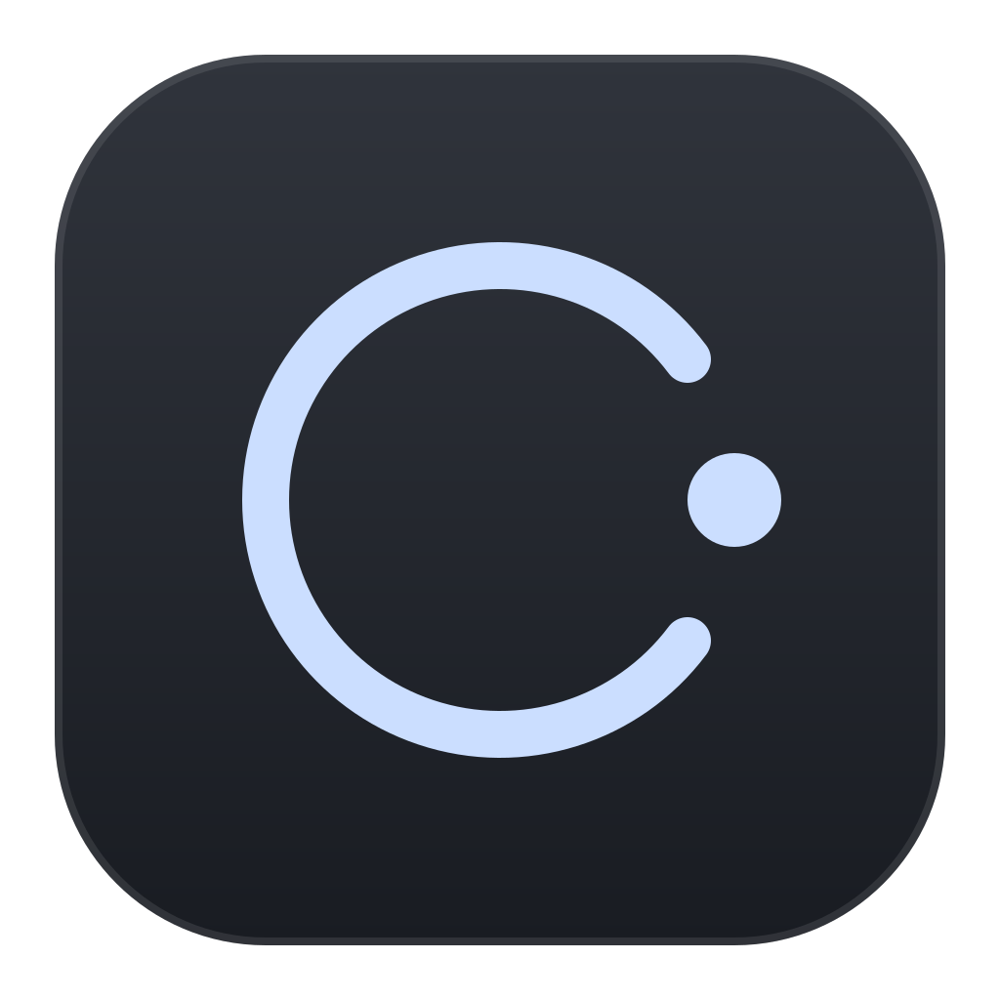
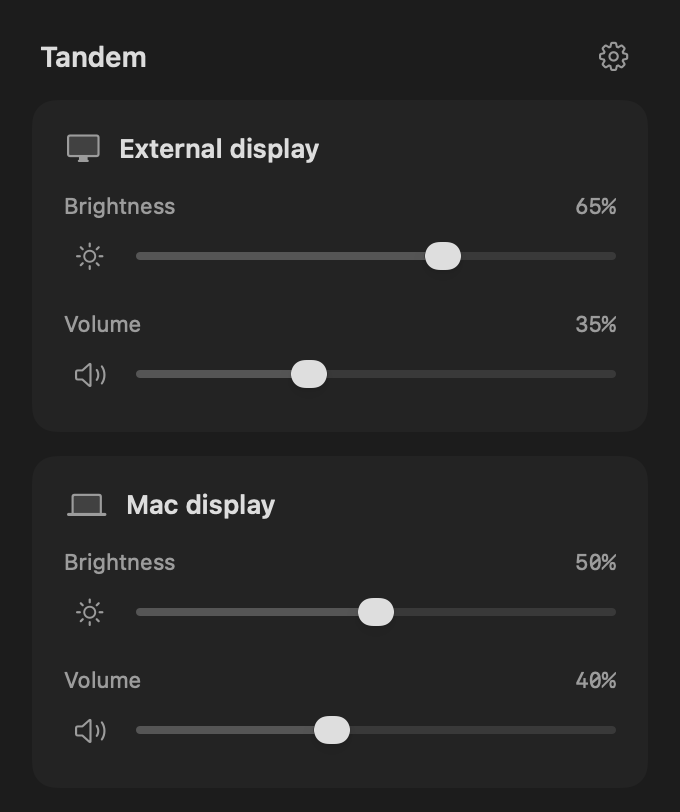
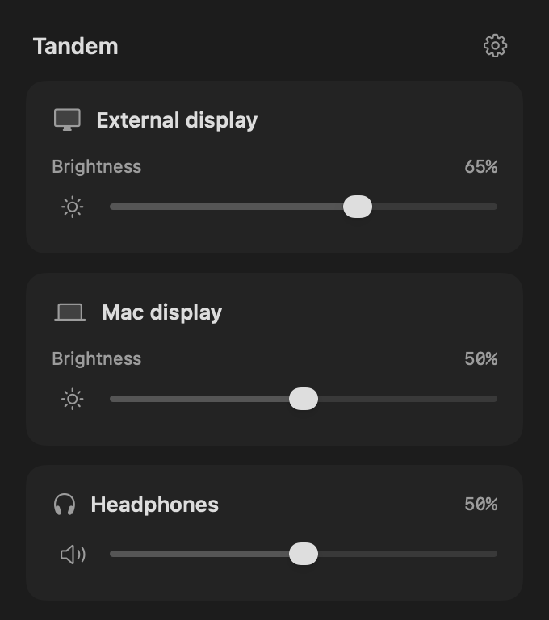

<p align="center">
  
</p>

<h1 align="center">Tandem</h1>

<p align="center">Brightness and volume controls for the screen under your pointer.</p>

<p align="center">
  <a href="https://github.com/oguzhandemirelx/tandem/releases/latest"></a>
  
  
</p>

<p align="center">
  
  
</p>

Move your pointer to a display and use the brightness, volume or mute keys. Tandem adjusts that screen’s brightness and speakers. Selected headphones take priority for volume and mute, while your playback output stays unchanged.

## Features

- Keyboard controls that follow your pointer.
- Menu bar sliders with precise percentage readouts.
- Automatic display detection and support for selected headphones.
- Launch at login and an optional menu bar icon.

## Install

**[Download the latest release →](https://github.com/oguzhandemirelx/tandem/releases/latest)**

1. Unzip the download and move **Tandem.app** to **Applications**.
2. Open the app and follow the setup steps.
3. Enable **Tandem** in **System Settings → Privacy & Security → Accessibility** to use keyboard controls.

Requires **macOS 14+** and an **Apple Silicon Mac**. Releases are Developer ID signed and notarized by Apple.

## Usage

Click the menu bar icon to adjust brightness and volume, or open Settings with the gear button. Hold **Shift + Option** with a brightness or volume key for smaller adjustments. If you hide the icon, reopen the app from Applications to access the controls.

External display controls require **DDC/CI** support from your monitor and connection. Available controls vary by hardware. Software dimming and virtual-display brightness are not supported. Enable DDC/CI in your monitor’s settings if needed. Some monitors report a different brightness value in their own on-screen menu.

## Build

With Xcode or Apple’s Command Line Tools installed:

```sh
git clone https://github.com/oguzhandemirelx/tandem.git
cd tandem
bash scripts/build.sh
bash scripts/test.sh
open build/Tandem.app
```

Built with Swift, C and native macOS frameworks. No third-party runtime dependencies.

[Report an issue](https://github.com/oguzhandemirelx/tandem/issues) · [Acknowledgments](THIRD_PARTY.md)
